# Process: McDonald's website (Task B)

How the website prototype went from a first build to what's live now: what Marie asked, what changed, what stayed, and why. Every prompt, word for word, is in [prompt.md](prompt.md).

**Live:** [marie-6.github.io/Mcdonalds/website](https://marie-6.github.io/Mcdonalds/website/) · **Spec:** [01 Design Spec](../docs/01-design-spec.md), [03 Website](../docs/03-website.md)

**Goal (Task B):** on mcdonalds.com you could only browse, and "Order Now" sent you to the app. The redesign lets you order on the website for pickup or delivery, with the same bag as the phone, and find past orders and receipts.

Pictures are screenshots of each earlier version, taken from the git history.

---

## 1. Setup

- Started as a folder in the class repo. **Marie decided** on a separate repo, `Marie-6/Mcdonalds`, so Xinyu could publish without touching other class work.
- The Figma file was view-only for Marie's account, so the spec came in as Markdown files plus PNG exports instead.
- Page 1 was renamed from "Shared System" to **Design Spec**, in the text and in the file names.

## 2. First working version

Built from the Design Spec and the website rules: a menu, a bag drawer, sign-in only at checkout, checkout, order history and receipts. Product photos were grey boxes.

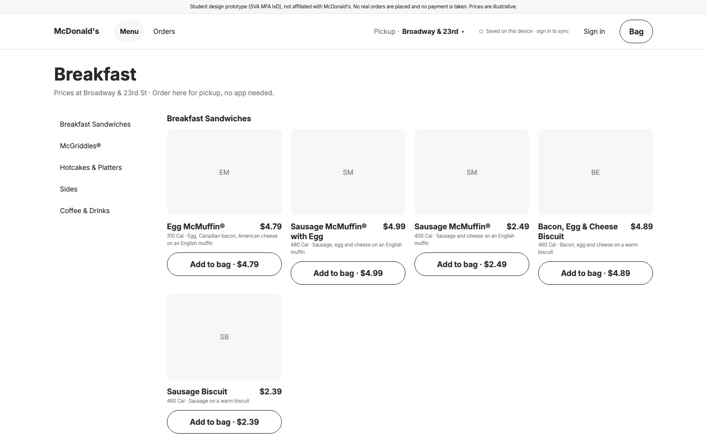

## 3. Real photos and logo

**Asked:** product photos and the logo, all following the spec.
**Changed:** real photos from mcdonalds.com and the Golden Arches. Photos with promo badges ("Protein 17g") were swapped for clean ones. Calorie numbers that had been guessed were removed.

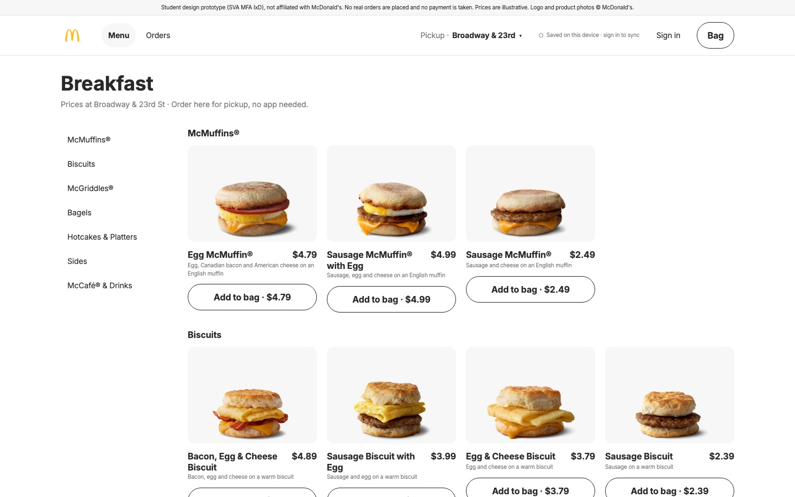

## 4. The real site's menu layout and a fuller header

**Asked:** keep the design of the real product menu; give the header more functions.
**Changed:** category rail with photos and a red bar on the current one; centered titles; large photos; Breakfast Meal Deals. The header has Our Menu (with photos), Meal Deals, Orders, More, a working Search, Pickup location and Bag.

| Before | After |
|---|---|
|  | 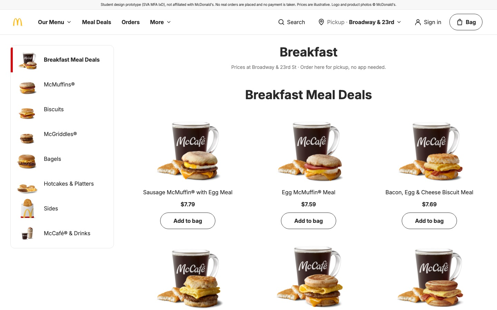 |

## 5. Customizing: from a full page to a pop-up

**Asked:** a product page to customize (like DoorDash), then: *"just jump out first, but not the whole page … make sure people can scan the details first and give them chance to hesitate."*
**Changed:**
- Remove/Extra lists come from each item's real ingredient list, and size and meal drink are required choices. Options follow the item into the bag, orders and receipt.
- Instead of DoorDash's "Ordered recently by 10+ others", **"Your usual"** shows how *you* ordered it before.
- It's a pop-up over the menu (a bottom sheet on phones). Details and "What's in it" come first, defaults are preselected, and **Customize is folded** until you open it.

| Full page (first try) | Pop-up (kept) |
|---|---|
| 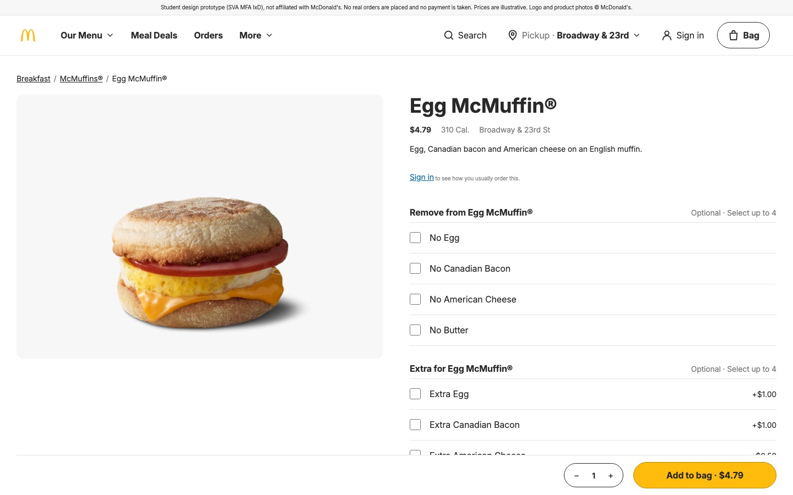 | 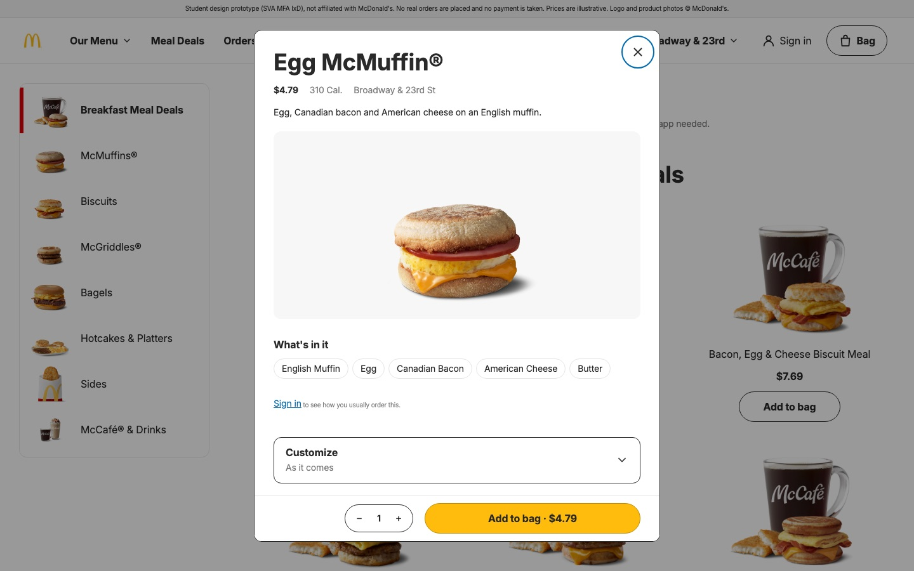 |

## 6. Following the design rules

### Dark outlines
**Asked:** *"why everything has a black liner outside the box?"*
**Why:** the spec says "no shadows", so I outlined floating layers in near-black. But the spec actually says to separate with a light divider or a Light Gray surface.

| Before | After |
|---|---|
|  |  |

### Full audit against the rule sheet
**Asked:** *"do you actually follow the design rules?"*
The different Bag and Checkout borders were correct (Primary = Gold + Gold Stroke, Secondary = white + outline). But a full audit found 9 real breaks, all fixed:

| Rule | Was | Now |
|---|---|---|
| Colors from the palette only | Lines in #E6E6E6 | Palette colors only |
| No shadows | Inset shadows on selected states | 1px border |
| No new radius values | 50% round buttons | 48px pill radius |
| 6 / 12 / 18 (+30) spacing | 48, 60, 40, 2px gaps | On the rhythm |
| 6-step type scale | 14px text with 20 or 23 line height | Body S 14/24 |
| Info Blue for accessibility only | Blue action links | Ink links; blue only for the focus ring |
| Every price with its restaurant | Search results without it | "Prices at …" |
| Bag and orders one tap away | Orders hidden in ☰ on smaller screens | Orders always in the header |
| A visible response to every tap | Missing pressed states | Added |

| Before | After |
|---|---|
| 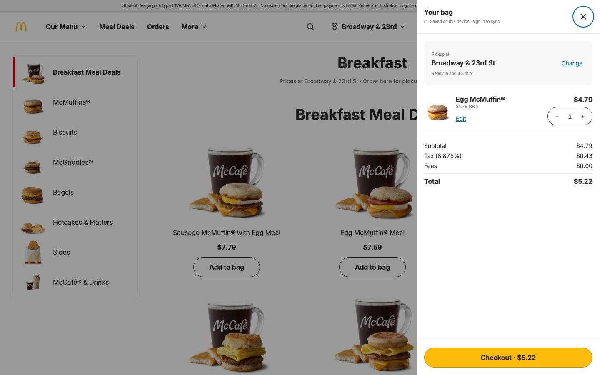 | 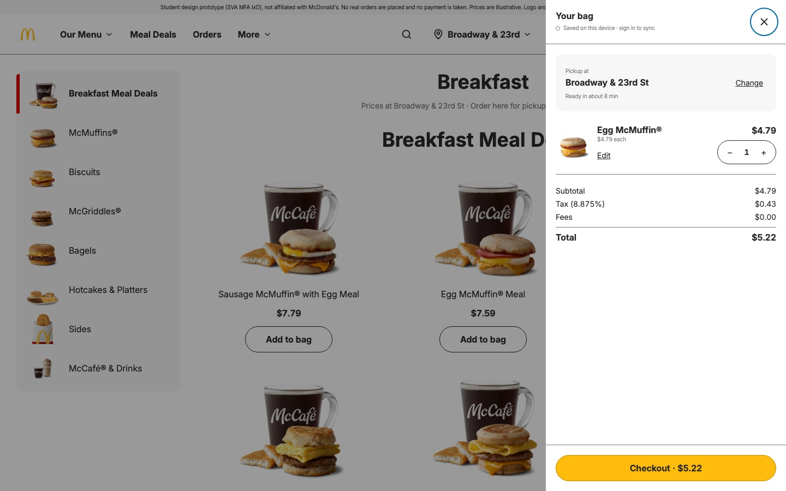 |

### The header that kept moving
**Asked:** *"why the head bar, stuff is drifting…"* (twice)
- **First fix:** digits got a fixed width, so a changing price can't change the button's width.
- **Still moving:** the header is pushed in from the right, so *any* slot whose text changed width moved the others. I measured up to **250px** of movement: Pickup ↔ Delivery, Sign in ↔ Marie, the bag badge appearing, the gold button appearing or disappearing, and the Checkout page losing its scrollbar.
- **Kept fix:** every header slot has a fixed width, and the scrollbar space is reserved. Positions are now identical across 10 states at 7 screen widths.

## 7. Delivery

**Asked:** *"it should have a "delivery " choice"*
**Changed:**
- The location menu has Pickup / Delivery tabs: an address (or the saved Home address) and a restaurant to deliver from.
- The **$2.99 fee is in the bag total straight away**, because the spec forbids "a total that hides fees until payment".
- Checkout has drop-off notes and pay on arrival, and orders and receipts say Pickup or Delivery.

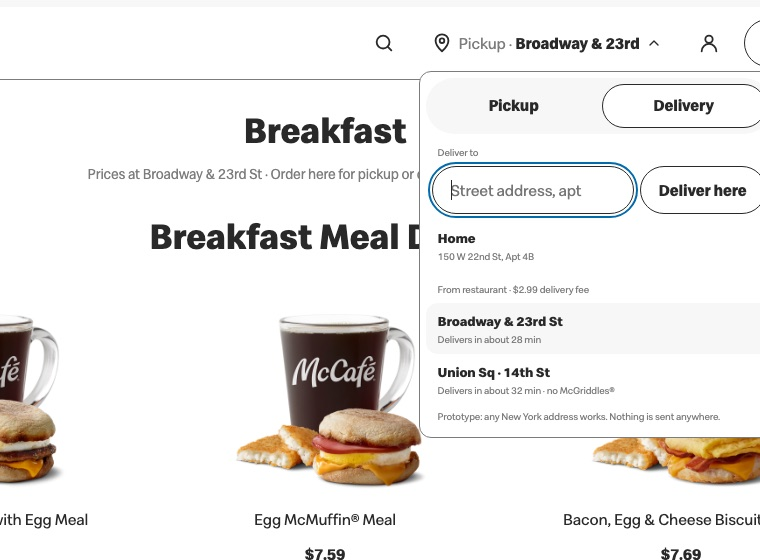

## 8. Lines: grey, and thin

**Asked:** *"the line of the top bar is kinda grey, not black"* and *"all the line should be grey … and not that thick"*
- The real site's header line is **#D6D6D6**. Added it to the spec palette as **Divider** and used it for every divider.
- Every line was already 1px; the dark color made them look thick.
- **Marie decided:** buttons, steppers and inputs get **Muted grey** (#7C7C7C) outlines, which still pass the 3:1 contrast controls need. Dark Ink is only on the selected option.
- Also removed the line above the bag's Checkout button.

| Header line before | Header line after |
|---|---|
| 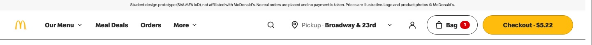 |  |

| Outlines before | Outlines after |
|---|---|
| 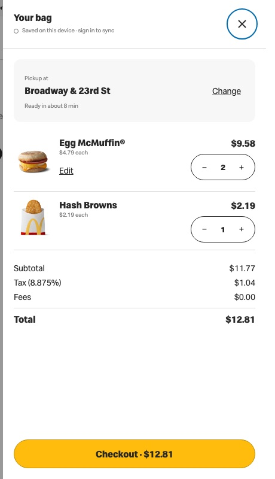 | 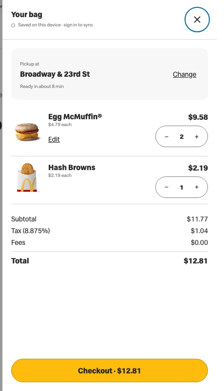 |

## 9. Font: Speedee

**Asked:** upload the Speedee font to GitHub and use it.
- The font file says "© McDonald's Corporation. All rights reserved". It's not publicly licensed, so it was **not uploaded**.
- **Marie decided:** use it only where it's installed. It's installed on Marie's Mac, the site uses Speedee there and Inter elsewhere, and `.gitignore` blocks font files.
- The first package had only **Bold**, so the page mixed Speedee Bold with Inter, which breaks "One family". Marie got **Speedee Regular**; now all text is Speedee, like mcdonalds.com.

| Inter only | Speedee Bold + Inter (mixed) | Speedee Regular + Bold (kept) |
|---|---|---|
| 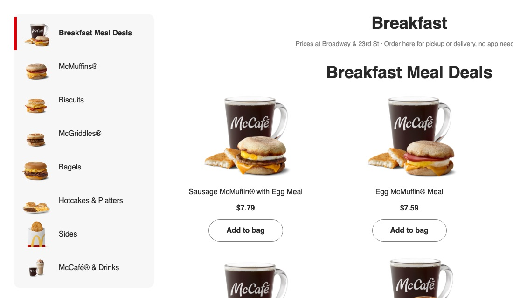 |  |  |

**Still open:** Marie wants everyone with the link to see Speedee. That would mean making the font file public, which I didn't do. The alternative on offer is screenshots or a video of the site in Speedee in the README.

## 10. Spacing and details

### Space around titles
**Asked:** *"why so little space? find a better space"*
- **Checkout:** the titles had no space under them (a style reset); they now have 12px.
- **Menu:** each category title sat closer to the section *above* than to its own products, because McDonald's photos leave empty space above the food. I measured where the food starts in all 33 photos and trimmed each category's frame to just above its tallest food, with nothing cropped. Now it's **60px between sections and 23px from a title to its food**.

| Before | After |
|---|---|
| 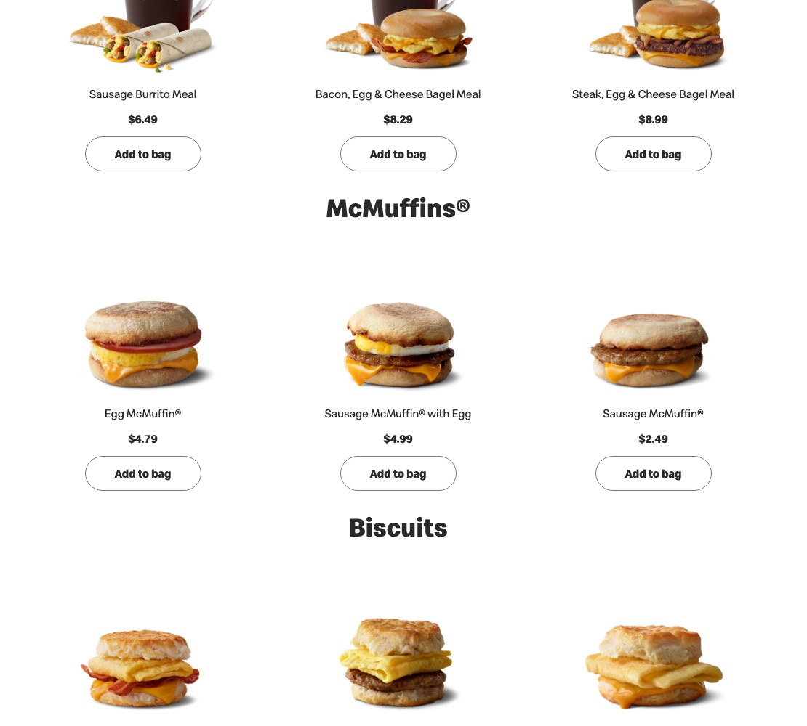 | 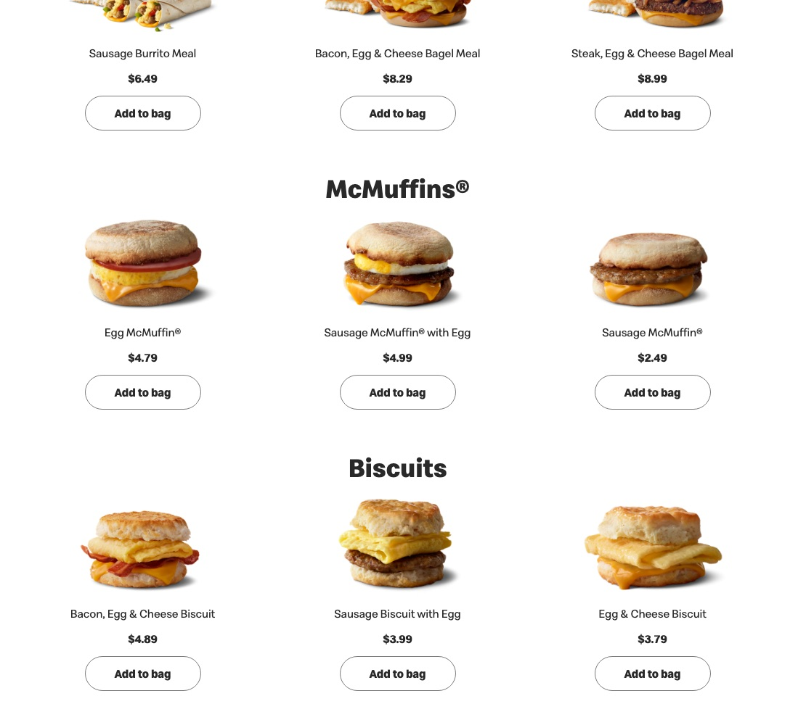 |
| 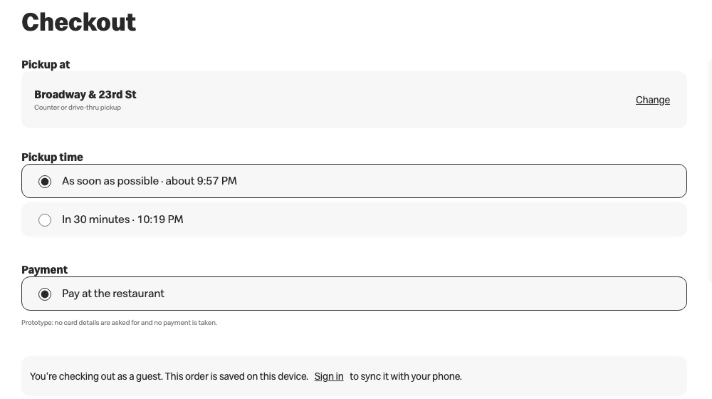 | 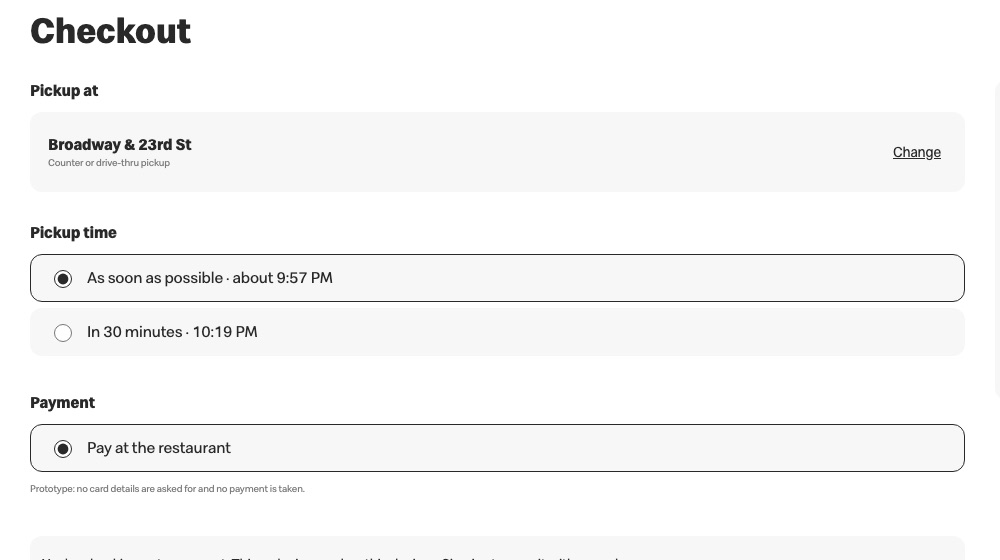 |

### Empty bag button
**Asked:** the gap after "Bag" when the bag is empty.
**Changed:** the button has a fixed width with centered contents, and the count appears from the first item.

| Before | After |
|---|---|
| 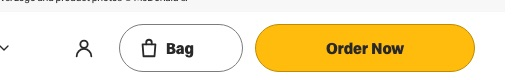 | 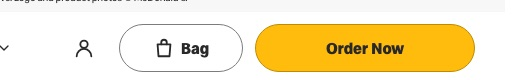 |

### Product name Bold, price Regular
**Asked:** *"it should be the name of the product in bold, price should be regulat"*
**Changed:** menu cards have the name in Bold and the price in Regular, 6px apart. Totals stay Bold. The spec rule changed from "Bold for … prices" to "Bold for headings, product names, totals and buttons; a product's own price is Regular".

| Before | After |
|---|---|
| 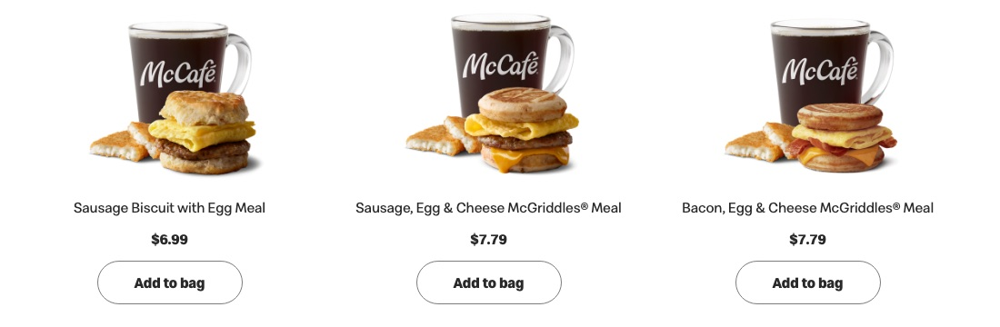 | 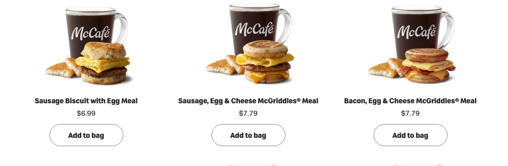 |

## 11. One demo page

**Asked:** combine the mobile app and the website on one page for demonstration.
**Changed:** [demo/](https://marie-6.github.io/Mcdonalds/demo/) shows the live website in a laptop frame and Xinyu's live app in a phone frame, side by side. Both are clickable, with "Try it" steps for each. The page uses the same Design Spec.

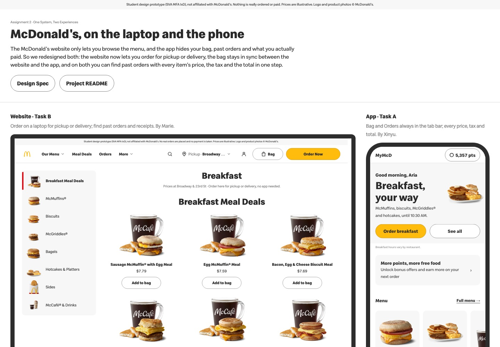

---

## Where it is now

| Menu | Product pop-up |
|---|---|
| 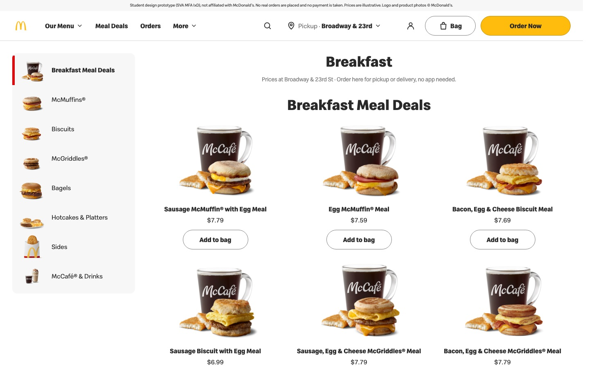 | 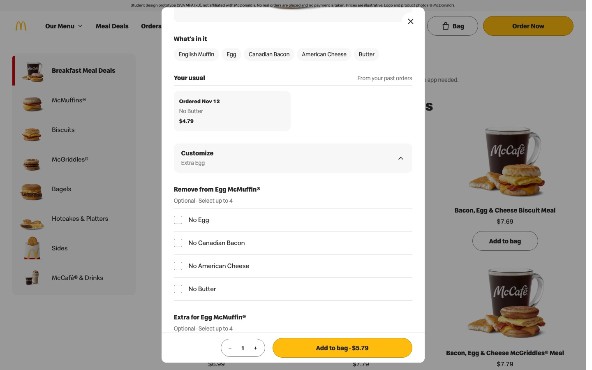 |
| **Bag (delivery)** | **Checkout** |
| 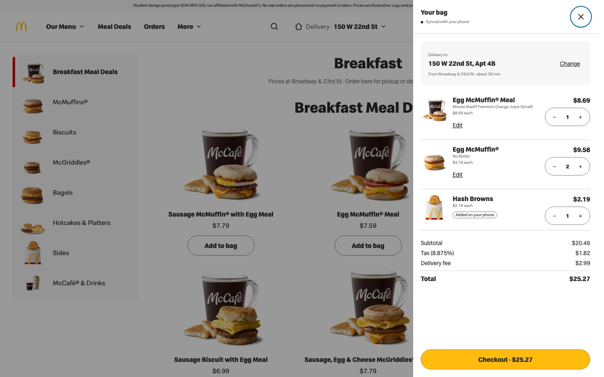 | 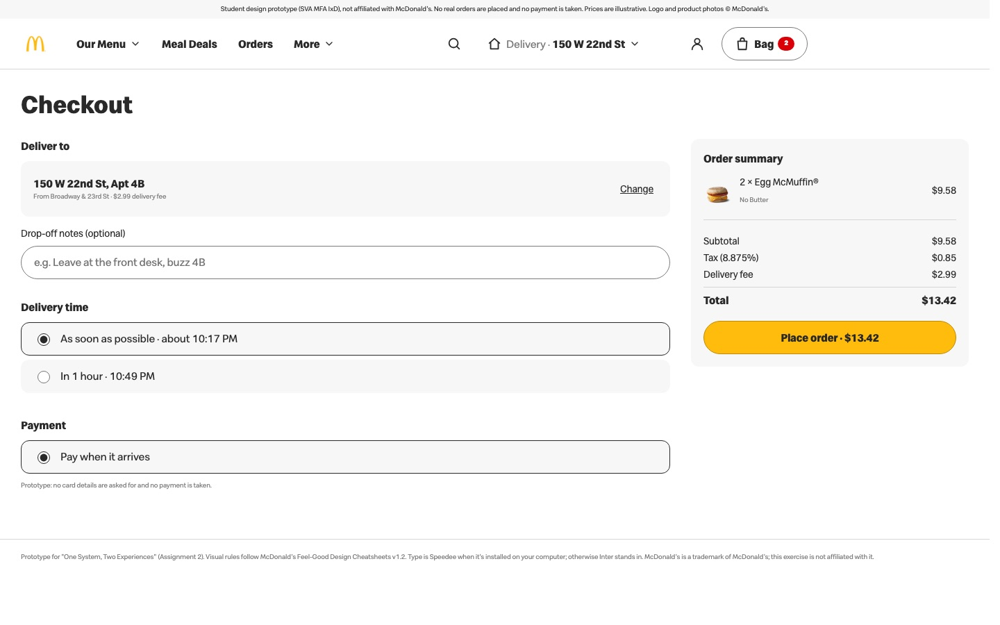 |
| **Orders** | |
| 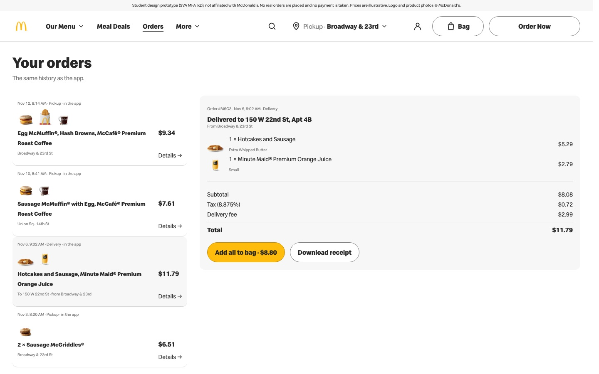 | |

## What we kept

- Ordering on the website, with one bag shared with the phone and sign-in asked only at checkout.
- The real site's menu layout, real photos and the Golden Arches.
- Customizing in a pop-up with details first, Customize folded, and "Your usual" from your own history.
- Pickup **and** Delivery, with the fee always visible before payment.
- Orders with every price, option, tax and fee, plus "Add all to bag" and receipts.
- A header that never moves.
- The spec's colors (plus Divider), lines, spacing, type scale, one Gold primary per screen, and no shadows.
- Speedee installed locally, never uploaded.

## What we changed along the way

| From | To | Why |
|---|---|---|
| A separate product page | A pop-up, Customize folded | Scan first, decide later |
| Near-black outlines | Light dividers or Light Gray surfaces | The spec forbids heavy separation |
| Muted (#7C7C7C) dividers | Divider #D6D6D6 | Matches the real site |
| Ink outlines on buttons | Muted grey outlines | Lighter look, still accessible |
| Inter → Speedee Bold + Inter | Speedee Regular + Bold | One family, like mcdonalds.com |
| Square photo frames | Frames trimmed per category | Titles sit with their own products |
| Bold prices on cards | Bold names, Regular prices | Like the real product cards |
| Pickup only | Pickup and Delivery | Delivery was missing |

## Decisions Marie made

1. A separate repo, shared only with Xinyu.
2. Product details pop up instead of opening a full page; people scan before customizing.
3. Speedee: use it only where installed, and don't upload it (prompt 19).
4. Grey outlines: Muted (#7C7C7C) on controls, Divider (#D6D6D6) for lines.
5. Every design change also updates the spec docs.
6. Product name Bold, price Regular.
7. Speedee should show for anyone with the link. Still open: the font wasn't made public; screenshots or a video were offered instead.

## What didn't work the first time

- **Reading Figma:** the file was view-only for Marie's account, so the spec was exported instead.
- **Header drift:** the first fix only covered the price. The real cause was every header slot changing width.
- **Checkbox options in the pop-up:** they didn't register at first (they were read from the wrong place). Caught in testing.
- **Checkout title spacing:** the first fix was cancelled by the heading style's margin reset.

## Next steps

- ~~Update the Figma Design Spec frame to match `docs/01-design-spec.md`~~ Done: Marie updated the Figma frame, and the new export replaced `assets/01-design-spec.png`.
- Decide how people without Speedee see the intended look: screenshots or a video in the README.
- Run the test from the spec: give a classmate only the link and ask them to "order an Egg McMuffin for pickup, then find what you paid last time".
